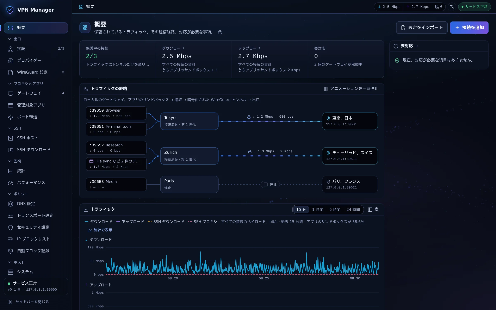
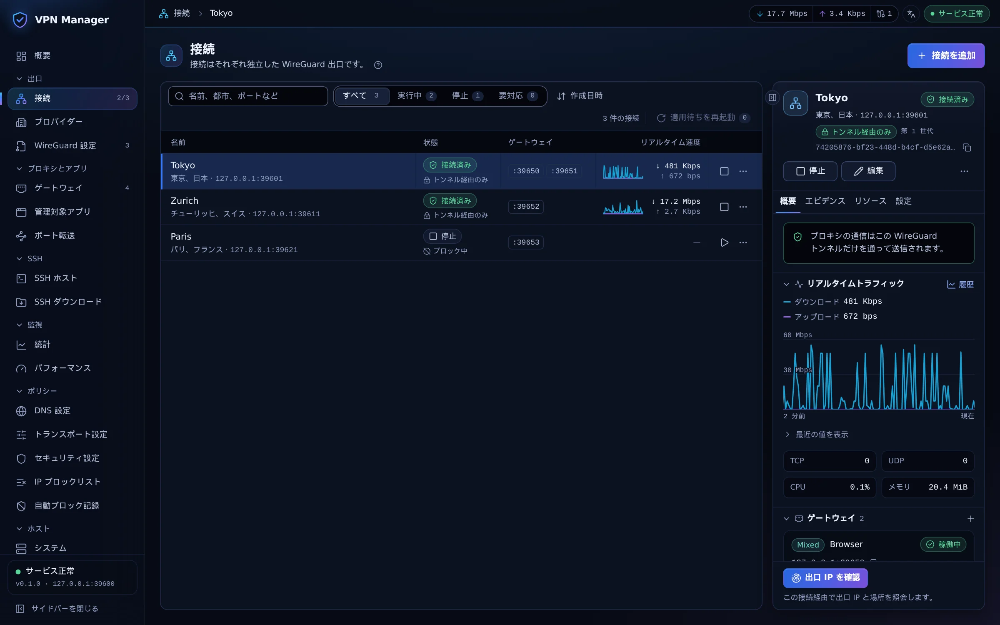
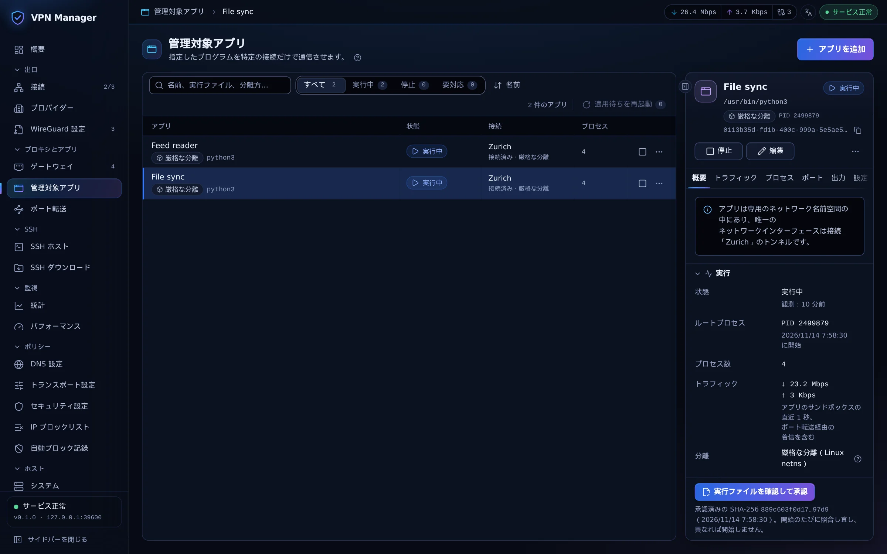
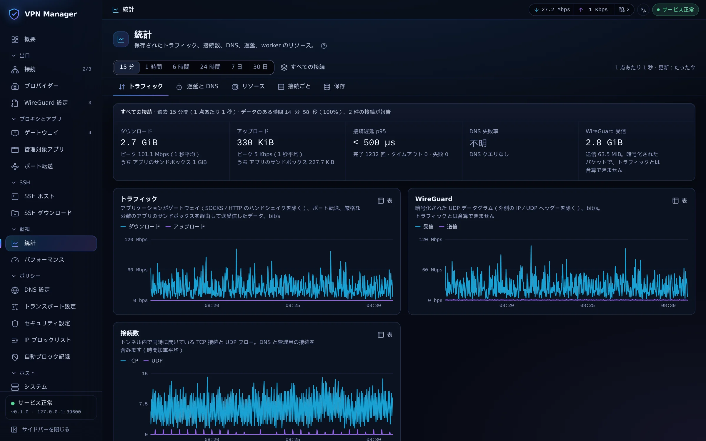

<p align="center">
  <a href="README.md">English</a> · <a href="README.zh-TW.md">繁體中文</a> · <b>日本語</b>
</p>

# VPN Manager

自分のコンピューターで複数の WireGuard 出口を同時に動かし、どのプログラムがどの出口を使うかを決められます。

それぞれの出口はローカルの SOCKS5／HTTP プロキシとして使えます。指定したプログラムを、そのトンネルだけが通信経路になる状態で起動することもできます。VPN Manager は自分のユーザー権限で動きます。root もカーネルモジュールも不要で、コンピューターのルーティング、ファイアウォール、DNS には一切手を加えません。ほかのプログラムはこれまでどおり通常のネットワークを使います。

**約束はひとつだけ：保護された通信は、その接続のトンネルから出ていくか、失敗するかのどちらかです。通常のネットワークに切り替わることはありません。**



<sub>この README の画面はデモ環境のもので、データはすべて架空です。</sub>

## できること

**複数の出口を同時に使う**

- 「接続」は、1 台のサーバーへの WireGuard トンネル 1 本です。いくつでも作れ、それぞれに出口、DNS、ルールを設定できます。
- WireGuard と TCP/IP スタックは VPN Manager 自身のプロセスの中で動きます（[GotaTun](https://github.com/mullvad/gotatun) と [smoltcp](https://github.com/smoltcp-rs/smoltcp)）。システムのネットワークには何もインストールしないので、後片付けは不要で、ほかのプログラムの接続方法も変わりません。

**接続に通信を流す 3 つの方法**

- **ゲートウェイ** — `127.0.0.1` 上のローカルプロキシポートです（SOCKS5、HTTP、または 1 つのポートで両方。UDP は SOCKS5 経由）。ブラウザーやコマンドラインツールの接続先に指定します。
- **管理対象アプリ** — VPN Manager がプログラムを起動し、1 つの接続に結び付けます。強さは 3 段階です。
  - 「環境変数」：プログラムにゲートウェイを使うよう伝えます。
  - 「強制プロキシ」（macOS）：プログラムはゲートウェイ以外に接続できず、その接続も IPv4 だけです（Java のプログラムは `-Djava.net.preferIPv4Stack=true` を付けて起動してください）。
  - 「厳格な分離」（Linux）：プログラムは専用の network namespace で動き、ネットワークインターフェースはトンネルだけになります。
- **SSH** — 指定した SSH ホストへ接続経由でつなぎます。リモートフォルダーの新しいファイルを SFTP で定期的に取得することもでき（「SSH ダウンロード」）、その通信は必ず VPN を通ります。

**つながらないときは通さない**

- 接続の準備ができていない間、そのゲートウェイは接続を拒否し、サンドボックス内のアプリにはネットワークがありません。通信は待つか失敗するだけで、直接外へ出ることはありません。
- 名前解決もトンネルを通ります（UDP、TCP、DNS over TLS、DNS over HTTPS）。保護された通信にコンピューター自身の DNS は使いません。
- 「緊急停止」は接続をただちに遮断し、解除するまで遮断したままにします。

**プロバイダーと連携**

- **Mullvad** と **AirVPN**：アカウントでサインインしてサーバーを一覧から選ぶと、VPN Manager が接続を作成します。入口と出口はあとから変更でき（Mullvad のマルチホップ、AirVPN の入口アドレス）、AirVPN の転送ポートも同じ画面で管理できます。
- **そのほかのプロバイダー**：標準の WireGuard 設定ファイルをインポートします。

**ポート転送**

- プロバイダーがトンネルへ転送するポートを、1 つの管理対象アプリに届けます。TCP、UDP、または両方に対応し、PROXY protocol v2 を付けてアプリに本当の送信元アドレスを伝えることもできます。

**接続ごとに設定できるルール**

- DNS 設定、セキュリティ設定（到達できるプライベートネットワーク、遮断するポート）、IP ブロックリスト（よく使われる公開リストを内蔵して自動更新。自分のリストも追加可能）、不正な着信元の自動ブロック。
- トランスポート設定（バッファー、タイムアウト、ヘルスチェック。固定、または往復時間から自動選択）と、速度とメモリーの上限。

**何が起きているかが見える**

- 「概要」で通信の経路、現在の速度、対応が必要な項目を確認できます。
- トラフィック、接続数、DNS、遅延の履歴を最大 30 日間保存し、各プロセスのリソース使用量も記録します。
- 診断機能がインストールの状態を調べ、問題があるときは対処方法を示します。

**Web インターフェースとコマンドライン**

- Web のワークベンチは `http://127.0.0.1:18765` で、英語、繁体字中国語、日本語に対応しています（ブラウザーの言語に従い、上部のバーから変更できます）。
- ターミナルでは `vpnctl` を使います（出力はいまのところ繁体字中国語のみ）。

## インストール

**要件**：Linux（x86_64 または aarch64、glibc 2.35 以降 — Ubuntu 22.04、Debian 12 以降 — で systemd のユーザーセッションがあること）、または macOS 11 以降（Apple シリコンまたは Intel）。root は不要です。

```sh
curl -fsSL https://raw.githubusercontent.com/DennySORA/vpn-manager/main/scripts/install.sh | sh
```

[`scripts/install.sh`](scripts/install.sh) は、このコンピューター用のインストーラーを[最新のリリース](https://github.com/DennySORA/vpn-manager/releases)からダウンロードし、SHA-256 が一致しなければ中止し、一致したときだけ実行します。インストーラーはプログラムをユーザーのデータディレクトリーに置き、ユーザー単位のサービス（Linux は systemd のユーザーユニット、macOS は launchd エージェント）として登録して起動します。同じコマンドをもう一度実行するとアップグレードになります。

そのあと **<http://127.0.0.1:18765>** を開きます。このポートが使用中なら、インストーラーは次の空きポートを選んで知らせます。

オプションは `sh -s --` の後ろに付けます。

```sh
curl -fsSL https://raw.githubusercontent.com/DennySORA/vpn-manager/main/scripts/install.sh | sh -s -- --version 0.2.0   # バージョンを指定
curl -fsSL https://raw.githubusercontent.com/DennySORA/vpn-manager/main/scripts/install.sh | sh -s -- --port 18765      # そのほかのオプションはインストーラーに渡される
```

**先に中身を確認したい場合**：リリースページからインストーラーと `.sha256` をダウンロードし、`sha256sum -c`（macOS は `shasum -a 256 -c`）で確認してから、実行権限を付けて自分で実行します。

**インストールの管理**

インストールされたプログラム（`vpn-installer` と `vpnctl`）は、データディレクトリーの `bin/` にあります（Linux：`~/.local/share/vpn-manager/bin`、macOS：`~/Library/Application Support/VPN Manager/bin`）。この README のコマンドは、このフォルダーが `PATH` に入っている前提です。入っていない場合はフルパスで指定してください。

```sh
vpn-installer status                 # 何がインストールされ、動いているか
./vpn-installer-<バージョン>-<os>-<arch> upgrade   # このバージョンに切り替える。新しいバージョンが起動しなければ自動的に元に戻る
vpn-installer uninstall              # サービスとプログラムを削除。データ、鍵、ログは残る
vpn-installer uninstall --purge      # データ、鍵、ログも削除（そのディレクトリーのほかのファイルには触れない）
vpn-installer licenses               # VPN Manager と、含まれるサードパーティソフトウェアのライセンス
```

- **保存場所**：ディレクトリー 1 つにまとまっています。Linux は `~/.local/share/vpn-manager`、macOS は `~/Library/Application Support/VPN Manager` です。プログラム、データベース、保存した秘密情報を暗号化する鍵（`vault.key`）、ログ、アップグレード時のバックアップが入っています。このディレクトリーをバックアップすると、その鍵も一緒にバックアップされます。
- **ネットワーク上のほかの機器から使う**：`install` または `upgrade` に `--listen-address 0.0.0.0 --allow-client <LAN の範囲（CIDR 表記）>` を付けます。先に[使う前に知っておくこと](#使う前に知っておくこと)を読んでください。ログインはありません。
- **ソースからビルドする**：[docs/development.md](docs/development.md)（繁体字中国語）を参照してください。

## 使い方

### 1. 出口を追加する

- **Mullvad または AirVPN のアカウントで**：**プロバイダー**を開き、**アカウントを追加**を選んでアカウントを入力し、サーバーを選んで接続を作成します。最初の 1 回は、プロバイダーに届くためのトンネルがまだないので、VPN Manager が直接接続を 1 回だけ許可するよう求めます。この接続は 10 分以内で、プロバイダー自身のアドレスに限られます。それ以降、プロバイダーへのリクエストは接続を通ります。
- **WireGuard 設定ファイルで**：**WireGuard 設定**を開き、**設定をインポート**を選んで内容を貼り付けるかファイルを選び、プレビューを確認してから、その設定で**接続を追加**します。

### 2. 開始する

**接続**を開いて接続を開始します。**接続済み**と表示されたら、**出口 IP を確認**を押すと、外から見えるアドレスと場所がわかります。



### 3. 通信を流す

**ゲートウェイ経由**。**ゲートウェイ**を開き、**ゲートウェイを追加**を選んで、接続、種類（SOCKS5、HTTP、または両方）、ポートを指定します。**プロキシアドレスをコピー**でアドレスを取り、プログラムに渡します。

```sh
curl --proxy socks5h://127.0.0.1:<ポート> https://example.com      # SOCKS5。名前解決もトンネル経由
curl --proxy http://127.0.0.1:<ポート> https://example.com         # HTTP
```

ブラウザーでは、同じアドレスとポートを SOCKS5 または HTTP プロキシとして入力します。

**管理対象アプリとして**。**管理対象アプリ**を開き、**アプリを追加**を選んで、プログラム、引数、接続、分離の強さを指定します。承認したときに VPN Manager がプログラムのフィンガープリントを記録し、ファイルが変わっていれば起動しません。開始と停止は一覧から行い、詳細パネルにはプロセス、待ち受けているポート、トラフィック、出力が表示されます。



**SSH で**。**SSH ホスト**を開き、接続を通したいホストを追加して、**Include を追加**を 1 回押します。それ以降、`ssh <エイリアス>` は VPN を通ります。**SSH ダウンロード**では、リモートフォルダーの新しいファイルをローカルフォルダーへ取得するジョブを追加できます。

### 4. 外からの接続を受ける（ポート転送）

プロバイダーがポートを転送している場合は、**ポート転送**を開いて**ポート転送を追加**を選び、どの管理対象アプリのどのポートで受けるかを指定します。転送は、そのアプリが実際にそのポートを保持している間だけ待ち受け、外部からの接続を実際に確認できたかどうかも表示します。

### 5. 状態を見守る

**概要**では、何が保護され、どこから出ていくかがわかります。**統計**は履歴を保存します。**システム**には診断があり、対応が必要なときは対処方法を示します。



### ターミナルから

```sh
vpnctl status                      # サービスとすべての接続
vpnctl instance list               # 接続
vpnctl instance start <名前>       # start、stop、restart
vpnctl emergency-stop <名前>       # 接続をただちに遮断
vpnctl app list                    # 管理対象アプリ
vpnctl doctor                      # インストールを検査
```

そのほか（ゲートウェイ、ポート転送、設定、プロバイダー、SSH、ブロックリスト、トランスポート設定）は `vpnctl --help` で確認できます。

## 使う前に知っておくこと

- **これは 0.2.0 です**。Linux x86_64 では毎日使われています。macOS と Linux aarch64 のインストーラーはリリースのワークフローでビルドされていますが、実際に使われた経験はずっと少なく、厳格な分離は Linux だけの機能です。API、設定、データ形式は、今後も互換性のない形で変わる可能性があります。
- **ログインはありません**。既定では、Web インターフェースと API はこのコンピューター上で、同じユーザーのプログラムにだけ応答します。これらを使える人は、あなたの権限でプログラムを起動できます。このアクセスはシェルと同じものとして扱ってください。ネットワークに公開すると、指定した範囲にあるすべての機器が同じことをでき、通信は暗号化されていない HTTP です。
- **ゲートウェイにパスワードはありません**。このコンピューター上のどのプログラムも、ゲートウェイを通じて動作中の接続を使えます。
- **分離の対象は通信経路です**。厳格な分離は、トンネルをプログラムの唯一の出口にします。信頼できないコードを動かすためのサンドボックスではありません。
- **root で実行しないでください。**

## ドキュメント

- [アーキテクチャと設計上の判断](docs/architecture.md)（繁体字中国語）
- [ビルド、チェック、パッケージ作成](docs/development.md)（繁体字中国語）
- [フロントエンドの設計規約](docs/frontend-design.md)（繁体字中国語）

## ライセンス

VPN Manager は [MIT](LICENSE-MIT) または [Apache-2.0](LICENSE-APACHE) のいずれかを選んで利用できます。**ただし AirVPN アダプターは例外です**。`crates/providers/src/airvpn` とそのテストは [GPL-3.0-or-later](LICENSE-GPL-3.0) です。このアダプターは、AirVPN 公式クライアント Eddie（GPL-3.0-or-later）のソースを参照して書かれたためです（両者の関係は [NOTICE](NOTICE) に記載）。`vpnd` はこのアダプターを含むので、`vpnd` とそれを含むインストーラーは GPL-3.0-or-later で配布されます。各リリースのソースは、そのタグ時点のこのリポジトリーです。

プログラムに含まれるサードパーティソフトウェアには、それぞれのライセンスが適用されます。すべてのインストーラーに完全な表示とライセンス文が入っており（`vpn-installer licenses`）、リリースにも `<インストーラー>.notices.txt` として添付されます。Web インターフェースに取り込んだコードは [web/THIRD_PARTY_NOTICES.md](web/THIRD_PARTY_NOTICES.md)、パッチを当てた smoltcp は [vendor/README.md](vendor/README.md) に記載しています。

AirVPN、Eddie、Mullvad、WireGuard はそれぞれの所有者の名称です。このプロジェクトは、いずれとも提携しておらず、承認も受けていません。
