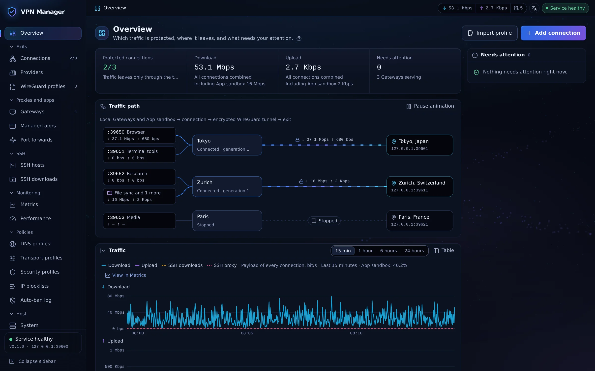
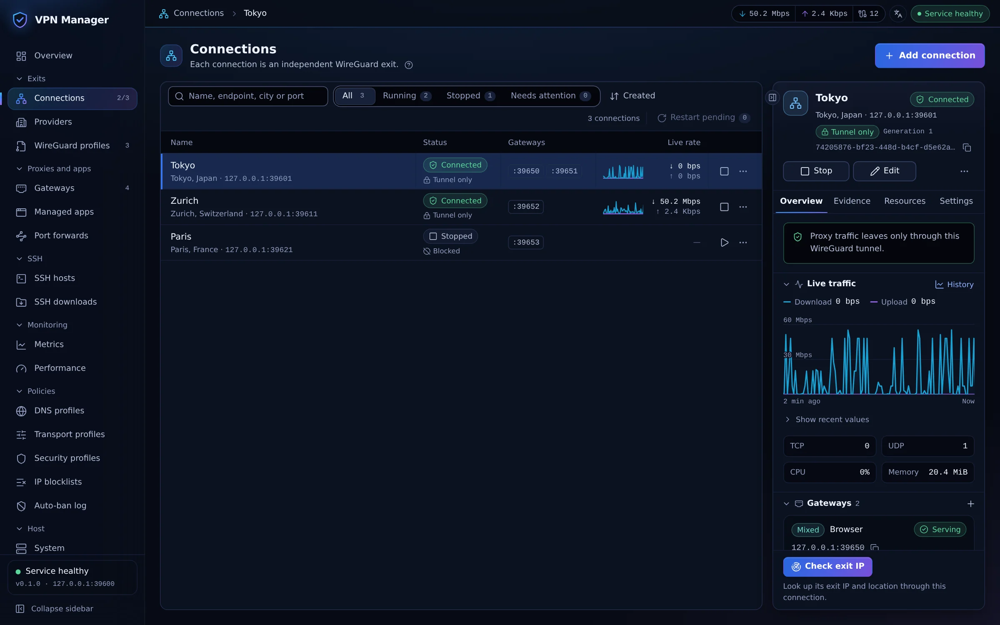
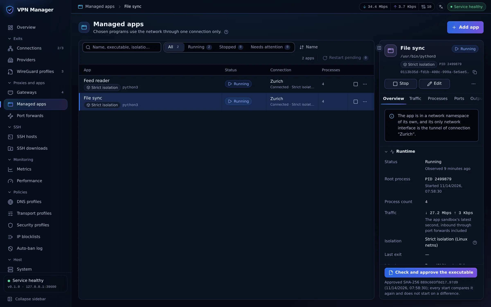
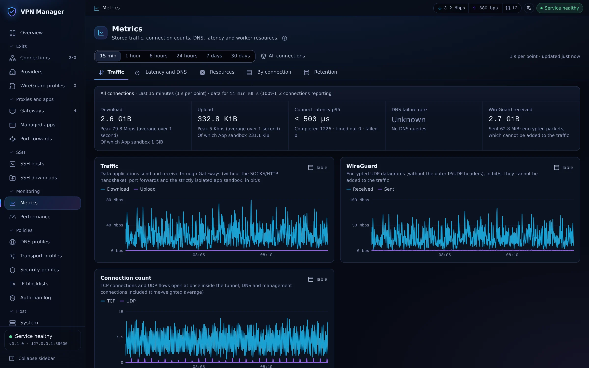

<p align="center">
  <b>English</b> · <a href="README.zh-TW.md">繁體中文</a> · <a href="README.ja.md">日本語</a>
</p>

# VPN Manager

Run several WireGuard exits side by side on your own computer, and decide which programs use which one.

[](LICENSE-APACHE)
[](https://github.com/DennySORA/vpn-manager/releases/latest)
[](https://github.com/DennySORA/vpn-manager#install)
[](https://github.com/DennySORA/vpn-manager/stargazers)

Each exit is reachable as a local SOCKS5/HTTP proxy, and a program you choose can be started so that the tunnel is its only way out. VPN Manager runs as your own user: no root, no kernel module, and your computer's routes, firewall and DNS stay exactly as they are. Everything else on the machine keeps using the normal network.

**The one promise: protected traffic either leaves through the tunnel of its connection, or it fails. It never falls back to the normal network.**



<sub>The screens in this README show a demo environment with made-up data.</sub>

## What it does

**Several exits at the same time**

- A *connection* is one WireGuard tunnel to one server. Run as many as you like, each with its own exit, DNS and rules.
- WireGuard and the TCP/IP stack run inside VPN Manager's own processes ([GotaTun](https://github.com/mullvad/gotatun) and [smoltcp](https://github.com/smoltcp-rs/smoltcp)). Nothing is installed into the system network, so there is nothing to clean up and nothing that changes how other programs connect.

**Three ways to send traffic through a connection**

- **Gateways** — local proxy ports on `127.0.0.1` (SOCKS5, HTTP, or both on one port; UDP through SOCKS5). Point a browser or a command-line tool at one.
- **Managed apps** — VPN Manager starts a program for you and ties it to one connection. Three levels:
  - *Environment variables*: the program is told to use the Gateway.
  - *Enforced proxy* (macOS): the program can reach nothing but the Gateway, and that only over IPv4 (start Java programs with `-Djava.net.preferIPv4Stack=true`).
  - *Strict isolation* (Linux): the program runs in a network namespace of its own, where the tunnel is the only network interface.
- **SSH** — let chosen SSH hosts connect through a connection, and pull new files from a remote folder over SFTP on a schedule ("SSH downloads"), only ever through the VPN.

**It fails closed**

- While a connection is not ready, its Gateways refuse and its sandboxed apps have no network. Traffic waits or fails; it does not go out directly.
- Names are resolved through the tunnel (UDP, TCP, DNS over TLS, DNS over HTTPS). The computer's own DNS is never used for protected traffic.
- Emergency stop blocks a connection at once and keeps it blocked until you release it.

**Works with your provider**

- **Mullvad** and **AirVPN**: sign in with your account, pick a server from the list, and VPN Manager creates the connection. Change the entry and exit later (Mullvad multihop, AirVPN entry addresses), and manage AirVPN's forwarded ports from the same screen.
- **Anything else**: import a standard WireGuard configuration file.

**Port forwards**

- Deliver a port your provider forwards into the tunnel to one managed app, over TCP, UDP or both, optionally with PROXY protocol v2 so the app sees the real source address.

**Rules you can set per connection**

- DNS profiles, security profiles (which private networks are reachable, blocked ports), IP blocklists (well-known public lists are built in and kept up to date; add your own) and automatic bans for abusive inbound sources.
- Transport profiles (buffers, timeouts, health probes; fixed, or chosen automatically from the round-trip time) and limits on rate and memory.

**You can see what is going on**

- Overview with the path of the traffic, live rates and anything that needs attention.
- History of traffic, connection counts, DNS and latency for up to 30 days, plus resource use of the processes.
- Diagnostics that check the installation and say what to do when something is wrong.

**Web interface and command line**

- A web workbench at `http://127.0.0.1:18765`, in English, Traditional Chinese and Japanese (it follows your browser's language; change it from the top bar).
- `vpnctl` for the terminal (its output is in Traditional Chinese for now).

## Install

**Requirements:** Linux (x86_64 or aarch64, glibc 2.35 or newer — Ubuntu 22.04, Debian 12 and later — with a systemd user session) or macOS 11 or newer (Apple silicon or Intel). No root needed.

```sh
curl -fsSL https://raw.githubusercontent.com/DennySORA/vpn-manager/main/scripts/install.sh | sh
```

[`scripts/install.sh`](scripts/install.sh) downloads the installer for this computer from the [latest release](https://github.com/DennySORA/vpn-manager/releases), stops if its SHA-256 does not match, and then runs it. The installer puts the programs in your user's data directory, registers them as per-user services (systemd user units on Linux, launchd agents on macOS) and starts them. Running the same command again upgrades.

Then open **<http://127.0.0.1:18765>**. If that port is taken, the installer picks the next free one and tells you.

Options go after `sh -s --`:

```sh
curl -fsSL https://raw.githubusercontent.com/DennySORA/vpn-manager/main/scripts/install.sh | sh -s -- --version 0.2.0   # a specific version
curl -fsSL https://raw.githubusercontent.com/DennySORA/vpn-manager/main/scripts/install.sh | sh -s -- --port 18765      # other options are passed to the installer
```

**Prefer to look first?** Download the installer and its `.sha256` from the release page, check it with `sha256sum -c` (macOS: `shasum -a 256 -c`), make it executable and run it yourself.

**Managing the installation**

The installed programs, `vpn-installer` and `vpnctl`, are in the `bin/` folder of the data directory (Linux: `~/.local/share/vpn-manager/bin`, macOS: `~/Library/Application Support/VPN Manager/bin`). The commands in this README assume that folder is on your `PATH`; otherwise give the full path.

```sh
vpn-installer status                 # what is installed and whether it runs
./vpn-installer-<version>-<os>-<arch> upgrade   # switch to this version; the previous one comes back by itself if the new one does not start
vpn-installer uninstall              # remove the services and programs; data, keys and logs stay
vpn-installer uninstall --purge      # also delete data, keys and logs (other files in that directory are left alone)
vpn-installer licenses               # licences of VPN Manager and of the third-party software inside it
```

- **Where everything lives:** one directory — `~/.local/share/vpn-manager` on Linux, `~/Library/Application Support/VPN Manager` on macOS. It holds the programs, the databases, the key that encrypts your stored secrets (`vault.key`), logs and upgrade backups. A backup of this directory includes that key.
- **Using it from other devices on your network:** add `--listen-address 0.0.0.0 --allow-client <your LAN in CIDR form>` to `install` or `upgrade`. Read [Good to know](#good-to-know) first: there is no login.
- **Building from source:** see [docs/development.md](docs/development.md) (Traditional Chinese).

## Using it

### 1. Add an exit

- **With a Mullvad or AirVPN account:** open **Providers**, choose **Add account**, enter the account, then pick a server and create the connection. The very first time there is no tunnel yet to reach the provider through, so VPN Manager asks you to allow one direct connection, limited to 10 minutes and to the provider's own addresses. After that, provider requests go through a connection.
- **With a WireGuard configuration file:** open **WireGuard profiles**, choose **Import profile**, paste the file or select it, check the preview, then **Add connection** with that profile.

### 2. Start it

Open **Connections** and start the connection. When it shows **Connected**, press **Check exit IP** to see the address and location the world sees.



### 3. Send traffic through it

**Through a Gateway.** Open **Gateways**, choose **Add Gateway**, pick the connection, the kind (SOCKS5, HTTP or both) and a port. Then use **Copy proxy address** and give it to your program:

```sh
curl --proxy socks5h://127.0.0.1:<port> https://example.com      # SOCKS5; the name is resolved through the tunnel
curl --proxy http://127.0.0.1:<port> https://example.com         # HTTP
```

In a browser, enter the same address and port as the SOCKS5 or HTTP proxy.

**As a managed app.** Open **Managed apps**, choose **Add app**, pick the program, its arguments, the connection and how strictly to isolate it. VPN Manager records the program's fingerprint when you approve it and refuses to start it if the file has changed. Start and stop it from the list; the detail panel shows its processes, the ports it listens on, its traffic and its output.



**Over SSH.** Open **SSH hosts**, add the hosts that should go through a connection and press **Add Include** once; after that `ssh <alias>` uses the VPN. **SSH downloads** adds jobs that fetch new files from a remote folder into a local one.

### 4. Receive connections (port forwards)

If your provider forwards a port to you, open **Port forwards**, choose **Add port forward**, and say which managed app and port should receive it. The forward listens only while that app really holds the port, and shows when a connection from outside was actually seen.

### 5. Keep an eye on it

**Overview** shows what is protected and where it leaves. **Metrics** keeps the history. **System** has diagnostics and tells you what to do when something needs attention.



### From the terminal

```sh
vpnctl status                      # the service and every connection
vpnctl instance list               # connections
vpnctl instance start <name>       # start, stop, restart
vpnctl emergency-stop <name>       # block a connection at once
vpnctl app list                    # managed apps
vpnctl doctor                      # check the installation
```

`vpnctl --help` lists everything else (Gateways, port forwards, profiles, providers, SSH, blocklists, transport profiles).

## Good to know

- **This is 0.2.0.** It is used every day on Linux x86_64. macOS and Linux aarch64 installers are built by the release workflow, but they have had much less real use; strict isolation exists on Linux only. The API, the configuration and the data formats may still change in incompatible ways.
- **There is no login.** By default the web interface and the API answer only on this computer and only to programs of the same user. Whoever can use them can start programs as you, so treat that access like a shell. If you open it to your network, every device in the networks you list gets the same access, over plain HTTP.
- **Gateways have no password.** Any program on this computer can use a running connection through its Gateway.
- **Isolation is about the network path.** Strict isolation makes the tunnel the only way out for a program; it is not a sandbox for running code you do not trust.
- **Do not run it as root.**

## Documentation

- [Architecture and design decisions](docs/architecture.md) (Traditional Chinese)
- [Building, checking and packaging](docs/development.md) (Traditional Chinese)
- [Frontend design contract](docs/frontend-design.md) (Traditional Chinese)

## Licence

VPN Manager is licensed under [MIT](LICENSE-MIT) or [Apache-2.0](LICENSE-APACHE), at your option, **except its AirVPN adapter**: `crates/providers/src/airvpn` and its tests are licensed under [GPL-3.0-or-later](LICENSE-GPL-3.0), because the adapter was written with reference to the source of AirVPN's official client Eddie, which is GPL-3.0-or-later ([NOTICE](NOTICE) describes the relation). `vpnd` contains that adapter, so `vpnd` and the installers that carry it are distributed under GPL-3.0-or-later; the source of every release is this repository at the release's tag.

Third-party software inside the programs keeps its own licences: every installer carries the full notices and licence texts (`vpn-installer licenses`), and each release also has them as `<installer>.notices.txt`. Code adapted into the web interface is listed in [web/THIRD_PARTY_NOTICES.md](web/THIRD_PARTY_NOTICES.md), the patched smoltcp in [vendor/README.md](vendor/README.md).

AirVPN, Eddie, Mullvad and WireGuard are names of their owners; this project is not affiliated with or endorsed by any of them.
