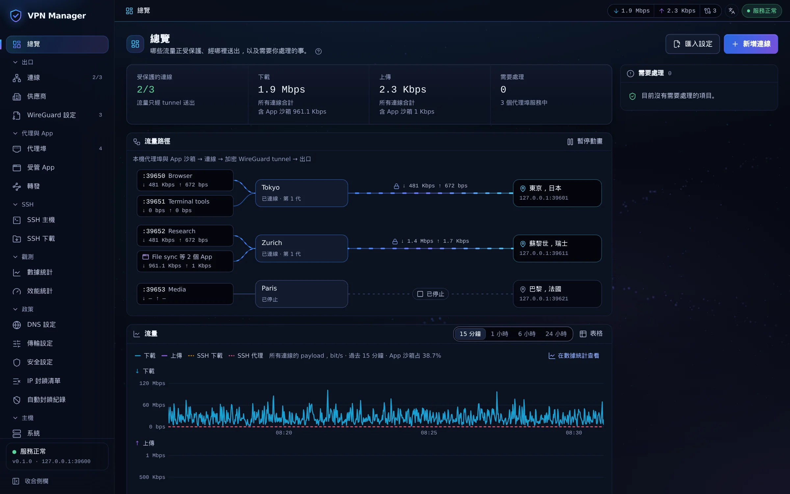
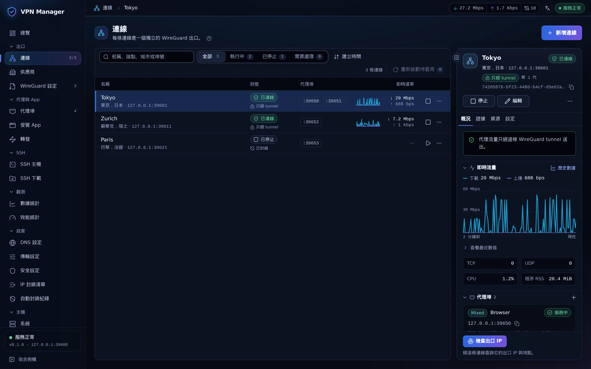
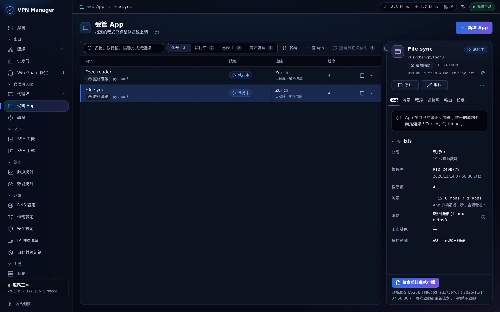
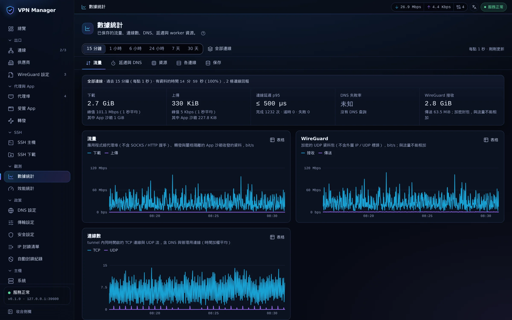

<p align="center">
  <a href="README.md">English</a> · <b>繁體中文</b> · <a href="README.ja.md">日本語</a>
</p>

# VPN Manager

在自己的電腦上同時跑好幾個 WireGuard 出口，並決定哪些程式走哪一個。

每個出口都是一個本機的 SOCKS5／HTTP 代理埠；你也可以讓指定的程式啟動後只能經那條 tunnel 上網。VPN Manager 以你自己的使用者身分執行：不需要 root、不裝核心模組，電腦原本的路由、防火牆與 DNS 完全不動，其他程式照常使用原來的網路。

**唯一的承諾：受保護的流量只有兩種結局——經它所屬連線的 tunnel 送出，或失敗。絕不會退回一般網路。**



<sub>這份 README 的畫面來自示範環境，資料都是假的。</sub>

## 功能

**同時使用多個出口**

- 一條「連線」就是到一台伺服器的一條 WireGuard tunnel。要開幾條都可以，各有自己的出口、DNS 與規則。
- WireGuard 與 TCP/IP 都在 VPN Manager 自己的程序裡執行（[GotaTun](https://github.com/mullvad/gotatun) 與 [smoltcp](https://github.com/smoltcp-rs/smoltcp)），不在系統網路裡安裝任何東西：沒有東西要清理，也不會改變其他程式的連線方式。

**三種把流量送進連線的方式**

- **代理埠**——在 `127.0.0.1` 上的本機代理（SOCKS5、HTTP，或同一個埠兩者都收；UDP 經 SOCKS5）。把瀏覽器或命令列工具指向它就行。
- **受管 App**——由 VPN Manager 幫你啟動程式，並把它綁在一條連線上。有三種強度：
  - 「環境變數」：告訴程式去用代理埠。
  - 「強制代理」（macOS）：程式除了代理埠之外哪裡都連不到，而且只能以 IPv4 連（Java 程式啟動時要加 `-Djava.net.preferIPv4Stack=true`）。
  - 「嚴格隔離」（Linux）：程式在自己的 network namespace 裡執行，tunnel 是唯一的網路介面。
- **SSH**——讓指定的 SSH 主機經某條連線連出去；也能定時從遠端資料夾以 SFTP 抓新檔案（「SSH 下載」），而且只經 VPN。

**連不上就不通，不會偷偷直連**

- 連線還沒就緒時，它的代理埠會拒絕連線，沙箱裡的 App 沒有網路。流量只會等待或失敗，不會直接出去。
- 名稱解析也經 tunnel（UDP、TCP、DNS over TLS、DNS over HTTPS）；受保護的流量從不使用電腦本身的 DNS。
- 「急停」會立刻封鎖一條連線，直到你解除為止。

**搭配你的 VPN 供應商**

- **Mullvad** 與 **AirVPN**：用帳號登入、從清單挑伺服器，VPN Manager 就幫你建立連線。之後可以更換入口與出口（Mullvad 多跳、AirVPN 的入口位址），AirVPN 的連入埠也在同一個畫面管理。
- **其他供應商**：匯入標準的 WireGuard 設定檔。

**轉發（連入埠）**

- 把供應商轉進 tunnel 的埠交給某一個受管 App，TCP、UDP 或兩者皆可；可以加上 PROXY protocol v2，讓 App 看得到真正的來源位址。

**每條連線各自的規則**

- DNS 設定、安全設定（可連到哪些私有網段、要封鎖的埠）、IP 封鎖清單（內建常見的公開清單並自動更新，也能加自己的），以及對惡意連入來源的自動封鎖。
- 傳輸設定（緩衝、逾時、健康探測；固定，或依往返時間自動選擇），以及速率與記憶體上限。

**看得到發生了什麼事**

- 「總覽」顯示流量的路徑、即時速率，以及需要你處理的事。
- 流量、連線數、DNS 與延遲的歷史最多保存 30 天，另有各程序的資源用量。
- 診斷功能會檢查安裝狀態，出問題時告訴你該怎麼做。

**網頁介面與命令列**

- 網頁工作台在 `http://127.0.0.1:18765`，有繁體中文、英文與日文（跟隨瀏覽器的語言，也能從頂欄切換）。
- 終端機用 `vpnctl`（目前輸出只有繁體中文）。

## 安裝

**需求**：Linux（x86_64 或 aarch64，glibc 2.35 以上——Ubuntu 22.04、Debian 12 之後——並有 systemd 的使用者工作階段），或 macOS 11 以上（Apple silicon 或 Intel）。不需要 root。

```sh
curl -fsSL https://raw.githubusercontent.com/DennySORA/vpn-manager/main/scripts/install.sh | sh
```

[`scripts/install.sh`](scripts/install.sh) 會從[最新的 release](https://github.com/DennySORA/vpn-manager/releases) 下載這台電腦適用的安裝檔，SHA-256 不符就停止，相符才執行。安裝檔把程式放進你的使用者資料目錄，註冊成使用者層級的服務（Linux 是 systemd 使用者服務，macOS 是 launchd agent）並啟動。同一個指令再跑一次就是升級。

接著打開 **<http://127.0.0.1:18765>**。這個埠被占用時，安裝程式會改用下一個空的埠並告訴你。

選項接在 `sh -s --` 後面：

```sh
curl -fsSL https://raw.githubusercontent.com/DennySORA/vpn-manager/main/scripts/install.sh | sh -s -- --version 0.2.0   # 指定版本
curl -fsSL https://raw.githubusercontent.com/DennySORA/vpn-manager/main/scripts/install.sh | sh -s -- --port 18765      # 其餘選項會交給安裝程式
```

**想先看過再執行**？到 release 頁下載安裝檔與它的 `.sha256`，用 `sha256sum -c`（macOS：`shasum -a 256 -c`）核對，加上執行權限後自己執行。

**管理這份安裝**

安裝好的程式（`vpn-installer` 與 `vpnctl`）在資料目錄的 `bin/` 裡（Linux：`~/.local/share/vpn-manager/bin`，macOS：`~/Library/Application Support/VPN Manager/bin`）。這份 README 的指令假設這個資料夾已經在 `PATH` 裡；沒有的話請寫完整路徑。

```sh
vpn-installer status                 # 裝了什麼、有沒有在執行
./vpn-installer-<版本>-<os>-<arch> upgrade   # 換成這個版本；新版本起不來時會自動回到原本的版本
vpn-installer uninstall              # 移除服務與程式；資料、金鑰與日誌保留
vpn-installer uninstall --purge      # 連資料、金鑰與日誌一起刪除（那個目錄裡其他的檔案不會動）
vpn-installer licenses               # VPN Manager 與內含第三方軟體的授權
```

- **東西都放在哪裡**：同一個目錄——Linux 是 `~/.local/share/vpn-manager`，macOS 是 `~/Library/Application Support/VPN Manager`。裡面有程式、資料庫、用來加密已存秘密的金鑰（`vault.key`）、日誌與升級備份。備份這個目錄，也就一併備份了那把金鑰。
- **讓區網裡的其他裝置使用**：在 `install` 或 `upgrade` 加上 `--listen-address 0.0.0.0 --allow-client <你的區網網段，CIDR 寫法>`。請先看[使用前要知道的事](#使用前要知道的事)：它沒有登入。
- **從原始碼建置**：見 [docs/development.md](docs/development.md)。

## 操作

### 1. 加入一個出口

- **用 Mullvad 或 AirVPN 帳號**：打開**供應商**，按**加入帳號**並輸入帳號，接著挑一台伺服器建立連線。第一次使用時還沒有任何 tunnel 可以用來連到供應商，所以 VPN Manager 會請你允許一次直接連線：限時 10 分鐘，而且只連供應商自己的位址。之後對供應商的請求都經連線送出。
- **用 WireGuard 設定檔**：打開 **WireGuard 設定**，按**匯入設定**，貼上內容或選擇檔案，確認預覽，再用這份設定**新增連線**。

### 2. 啟動它

打開**連線**並啟動那條連線。顯示**已連線**之後，按**檢查出口 IP**，就能看到外界看到的位址與所在地。



### 3. 把流量送進去

**經代理埠**。打開**代理埠**，按**新增代理埠**，選擇連線、種類（SOCKS5、HTTP 或兩者）與埠號。接著按**複製代理位址**，交給你的程式：

```sh
curl --proxy socks5h://127.0.0.1:<埠> https://example.com      # SOCKS5；名稱也經 tunnel 解析
curl --proxy http://127.0.0.1:<埠> https://example.com         # HTTP
```

瀏覽器則是在 SOCKS5 或 HTTP 代理的欄位填入同一個位址與埠。

**當成受管 App**。打開**受管 App**，按**新增 App**，選擇程式、參數、連線與隔離的強度。你核准時，VPN Manager 會記下程式的指紋；檔案有變動就不會啟動它。啟動與停止都在清單上操作；詳細面板會顯示它的程序、監聽的埠、流量與輸出。



**經 SSH**。打開 **SSH 主機**，加入要經連線連出去的主機，並按一次**加入 Include**；之後 `ssh <別名>` 就會走 VPN。**SSH 下載**可以建立工作，把遠端資料夾的新檔案抓到本機資料夾。

### 4. 接收連入的連線（轉發）

供應商有轉一個埠給你的話，打開**轉發**，按**新增轉發**，指定由哪個受管 App 的哪個埠接收。只有那個 App 真的占著那個埠時轉發才會監聽，而且會顯示是否真的收到過外面連進來的連線。

### 5. 隨時查看

**總覽**顯示哪些流量受保護、從哪裡出去；**數據統計**保存歷史；**系統**有診斷，需要處理時會告訴你該怎麼做。



### 在終端機

```sh
vpnctl status                      # 服務與所有連線
vpnctl instance list               # 連線
vpnctl instance start <名稱>       # start、stop、restart
vpnctl emergency-stop <名稱>       # 立刻封鎖一條連線
vpnctl app list                    # 受管 App
vpnctl doctor                      # 檢查這份安裝
```

其餘的（代理埠、轉發、設定、供應商、SSH、封鎖清單、傳輸設定）見 `vpnctl --help`。

## 使用前要知道的事

- **這是 0.2.0**。它每天在 Linux x86_64 上使用。macOS 與 Linux aarch64 的安裝檔由 release 流程建置，但實際使用的經驗少得多；嚴格隔離只有 Linux 有。API、設定與資料格式之後還可能有不相容的變更。
- **沒有登入**。預設情況下，網頁介面與 API 只在這台電腦上回應，而且只回應同一個使用者的程式。能使用它們的人就能以你的身分啟動程式，所以請把這個存取權當成一個 shell。開放給區網之後，你列出的網段裡每一台裝置都有同樣的權限，而且走的是未加密的 HTTP。
- **代理埠沒有密碼**。這台電腦上的任何程式都能經代理埠使用執行中的連線。
- **隔離管的是網路路徑**。嚴格隔離讓 tunnel 成為程式唯一的出路；它不是用來執行不信任程式碼的沙箱。
- **不要用 root 執行。**

## 文件

- [架構與設計上的取捨](docs/architecture.md)
- [建置、檢查與打包](docs/development.md)
- [前端設計契約](docs/frontend-design.md)

## 授權

VPN Manager 以 [MIT](LICENSE-MIT) 或 [Apache-2.0](LICENSE-APACHE) 授權，擇一適用；**AirVPN 轉接器除外**：`crates/providers/src/airvpn` 與它的測試以 [GPL-3.0-or-later](LICENSE-GPL-3.0) 授權，因為它是參照 AirVPN 官方用戶端 Eddie（GPL-3.0-or-later）的原始碼寫的（[NOTICE](NOTICE) 寫明兩者的關係）。`vpnd` 內含這個轉接器，所以 `vpnd` 與內含它的安裝檔以 GPL-3.0-or-later 散布；每個 release 的原始碼就是這個 repo 在該 tag 的內容。

程式裡的第三方軟體各有自己的授權：每個安裝檔都內含完整的聲明與授權文字（`vpn-installer licenses`），release 另附 `<安裝檔>.notices.txt`。改寫進網頁介面的程式碼列在 [web/THIRD_PARTY_NOTICES.md](web/THIRD_PARTY_NOTICES.md)，修補過的 smoltcp 見 [vendor/README.md](vendor/README.md)。

AirVPN、Eddie、Mullvad 與 WireGuard 是各自擁有者的名稱；這個專案與它們沒有關係，也未獲它們背書。
